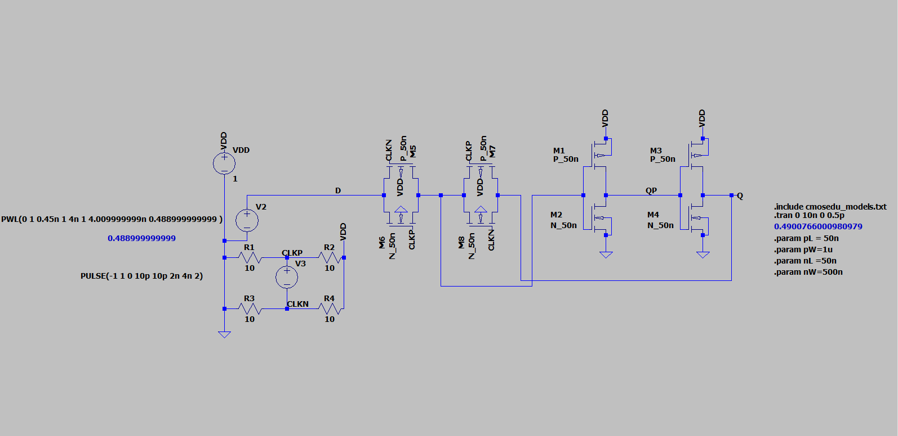

# Metastability Simulation

An LTspice experiment for visualizing metastability in a transistor-level storage circuit. Created for academic study under a professor's supervision, the project explores what happens when the data input changes near a clock transition.

## What the experiment shows

The supplied waveform illustrates a period in which the circuit's outputs remain at intermediate levels before resolving. Use it to study the interaction between input timing, clock edges, and the transistor models.

## Files

| File | Purpose |
| --- | --- |
| [Metastability_d_Latch_success.asc](LTspice-sources/Metastability_d_Latch_success.asc) | Main schematic, including a transient analysis command and CMOS model include |
| [MetaS_ltspice_sim_2.asc](LTspice-sources/MetaS_ltspice_sim_2.asc) | Additional experimental schematic |
| [cmosedu_models.txt](cmosedu_models.txt) | CMOS models referenced by the main schematic |
| [bsim461.nmos](bsim461.nmos), [bsim461.pmos](bsim461.pmos) | Additional supplied transistor model files |

## Run the main experiment

1. Open `LTspice-sources/Metastability_d_Latch_success.asc` in LTspice.
2. Make the model file available to the schematic. Its existing directive is `.include cmosedu_models.txt`, but the file is stored one directory above the schematic. Either copy `cmosedu_models.txt` beside the schematic in your working copy or change the directive to `.include ../cmosedu_models.txt`.
3. Run the existing `.tran 0 10n 0 0.5p` analysis: a 10 ns simulation with a 0.5 ps maximum timestep.
4. Probe the data input, clock, and storage-node outputs. Compare their transitions with the recorded waveform above.
5. To explore timing sensitivity, adjust the input pulse timing in small increments and record the model and simulation settings with each result.

## Interpretation and limitations

The original experiment repeatedly resolved to the same state. This is a limitation of the demonstration: the recorded simulation does not establish a statistical distribution of resolution outcomes or measure hardware failure rates. Results also depend on the stimulus, device models, and numerical settings.

Contributions that investigate this behavior are welcome. Include reproducible schematics, model paths, simulator settings, and waveform comparisons with a proposed change.

## Related demonstration

The original project also points to [Colin O'Flynn's FPGA metastability demonstration](https://www.youtube.com/watch?v=alRaqQzTPds) for a hardware-based companion to this simulation.

## License

GNU General Public License v3.0. See [LICENSE](LICENSE) for the license text.
